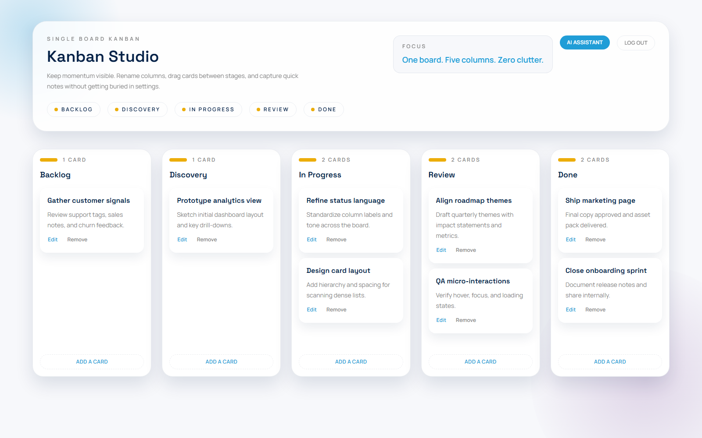

# Kanban AI

A Kanban project board with an AI assistant that can create, edit and move cards for you through chat.



## Features

- Sign in (MVP uses a fixed demo account: `user` / `password`)
- Kanban board with renamable columns
- Add, edit, delete and drag-and-drop cards
- AI chat sidebar that reads the board and can change one or more cards in a single request
- Board saved per user in SQLite and kept across restarts

## Tech stack

- Frontend: Next.js, React, TypeScript, Tailwind CSS, dnd-kit
- Backend: Python, FastAPI, Pydantic, SQLite, managed with uv
- AI: OpenRouter through the OpenAI Python SDK, with structured JSON outputs
- Packaging: a single multi-stage Docker image; FastAPI serves both the API and the static frontend on port 8000
- Tests: pytest, Vitest, Playwright

## Run with Docker

Requires Docker Desktop.

1. Create a `.env` file in the project root with your OpenRouter key:

   ```
   OPENROUTER_API_KEY=your-openrouter-key-here
   ```

   Get a key at https://openrouter.ai/keys. `.env` is git-ignored, so never commit it.

2. Start the app (Windows PowerShell):

   ```powershell
   .\scripts\start.ps1
   ```

   Open http://localhost:8000 and sign in with `user` / `password`.

3. Stop the app:

   ```powershell
   .\scripts\stop.ps1
   ```

On Mac/Linux use `scripts/start.sh` and `scripts/stop.sh`.

## Playwright tests

The end-to-end tests run against the running container, so start the app first.

```powershell
cd frontend
npm install
npx playwright install chromium
npm run test:e2e
```

The live AI chat test is skipped unless `OPENROUTER_API_KEY` is also set in your shell:

```powershell
$env:OPENROUTER_API_KEY = "your-openrouter-key-here"
npm run test:e2e
```

Unit tests: `npm run test:unit` (frontend) and `uv run pytest` (in `backend/`).
